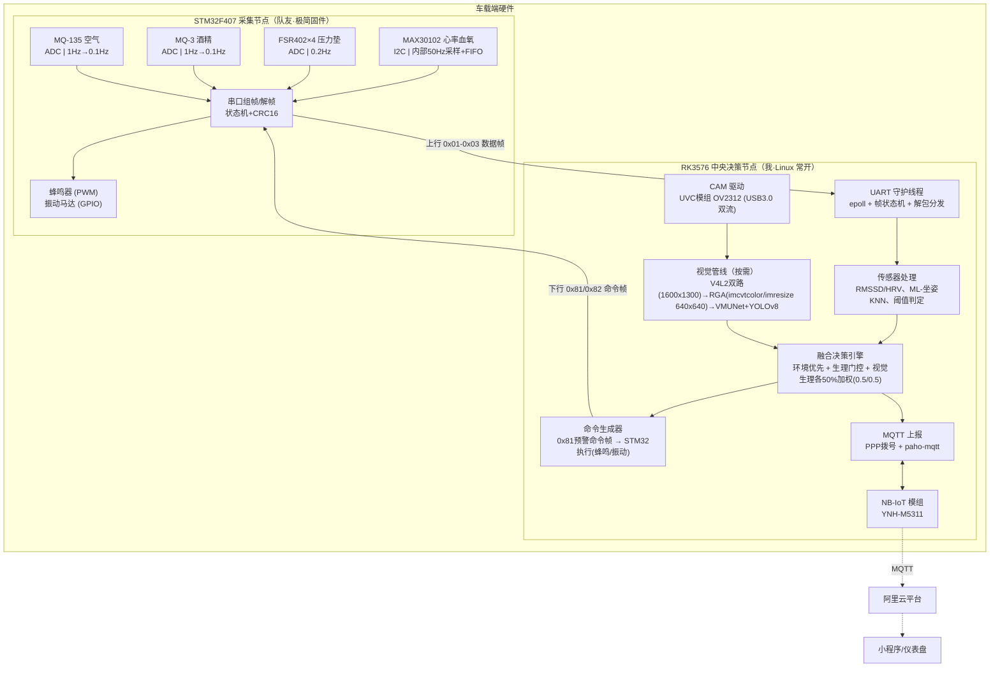

# 基于 AIoT 的健康驾驶辅助系统 —— 项目设计文档（v2 主从架构版）

> 第二十届中国研究生电子设计大赛 · 初赛二等奖
> 个人职责：RK3576 系统架构、全部算法实现（疲劳/坐姿/融合决策）、数据链路（NB-IoT + MQTT）、上位机守护进程；团队分工中队友负责 STM32 传感器采集固件。

---

## 0. 架构定稿声明

本版为**最终技术架构**：采用**主从式双主控**方案，RK3576 为中央大脑（常开、Linux），STM32F407 为纯采集前端（Sensor Hub）；所有智能（判定、融合、视觉、上报）收敛于 RK3576 一侧，芯片间仅通过一条**全双工 UART** 以自定义帧协议解耦。本文档详细定义了电气连接、软件分层、帧协议、模块行为与功耗域划分。

---

## 1. 项目背景与目标

| 面向群体 | 风险场景 | 本系统检测维度 |
|---|---|---|
| 网约车/出租车/货车司机 | 长时间驾驶 | 疲劳驾驶（眨眼频率、PERCLOS、哈欠、HRV 下降） |
| 长途私家车车主 | 单一姿势驾驶 | 坐姿不良（左倾/右倾/前倾/后瘫 → 腰部脊椎疲劳） |
| 代驾/宿醉人群 | 酒精 + 密闭 | 饮酒驾驶、空气质量（CO₂/VOCs 超标） |

**设计目标**
- ✅ 单一视觉模态失效场景（墨镜/逆光/夜间）下仍可靠检测 —— RGB+NIR 视觉 + 生理双通道互补；
- ✅ 边缘侧完成 95% 以上决策，云只做展示与告警记录；
- ✅ 跨车型"坐垫端 + 仪表台玩偶端"模块化，独立供电、改装零侵入；
- ✅ 极简 MCU 固件（仅采集+转发），队友可短期并行开发、零业务理解依赖。

---

## 2. 系统总体架构（主从式）

### 2.1 架构全景图



### 2.2 职责边界（一句话）

| 芯片 | 做什么 | 不做什么 |
|---|---|---|
| **STM32** | 定时采样、组帧、执行预警命令 | ❌ 判定（没有坐姿/疲劳阈值）、❌ 决策、❌ 联网 |
| **RK3576** | 全部判定、融合、AI 推理、网络上行、预警命令生成 | ❌ 裸 ADC 采样（没有那么多通道，也没必要） |

### 2.3 对比原设计（STM32 判定版）的改进

| 项 | 原（判定在 STM32） | 现（判定在 RK3576） |
|---|---|---|
| 合作边界 | 队友需懂判定逻辑 | 队友仅需"采集+转发"模板代码 |
| 算法调试 | 无断点、全靠 printf | gdb / valgrind / Claude Code 全工具链 |
| 时间戳 | 跨芯片时钟域错乱风险 | 融合线程本地时基，STM32 TICK 仅作参考 |
| MCU 固件 | 需阈值+策略+功耗管理 | 仅 ADC/I2C/UART 三板斧，固件量 -60% |
| 代码迁移性 | 判定锁在 M4 指令与片上资源 | 算法纯 C++/Python，迁移到 RK3588/Jetson 零改 |

---

## 3. 硬件接线详表

### 3.1 STM32 侧（两款"采集"外设 + "预警"外设）

| 外设 | 引脚/接口 | 采样方式 | 备注 |
|---|---|---|---|
| MAX30102 | I2C SDA/SCL + INT→GPIO | 内部时钟 50sps，FIFO 批量读 | IR/RED 原始值打包上传 |
| FSR402 ×4 | ADC1_IN8/9/10/11 | 定时器触发 DMA | 0.2 Hz；电压直接读，无计算 |
| MQ-3 | ADC1_IN12 | 定时器触发 DMA | 1 Hz → 支持降级 0.1 Hz |
| MQ-135 | ADC1_IN13 | 同上 | 同上 |
| 蜂鸣器 | PWM TIM3_CH1 | GPIO/PWM | 下行命令驱动 |
| 振动马达 | GPIO + 1 三极管 | 普通 IO | 同上 |
| UART1 | PA9(TX)/PA10(RX) | USART + DMA | **全双工**对接 RK3576 |

### 3.2 RK3576 侧（你负责）

| 外设 | 接口 | 作用 | Linux 访问 |
|---|---|---|---|
| STM32 UART | `/dev/ttyS1` | 主从通信收/发 | `termios` + `epoll` |
| OV2312 (UVC模组) | USB3.0 | RGB (1600x1300, YUV422) + NIR (1600x1300, GREY) 双流 | `/dev/videoX` 与 `/dev/videoY` (V4L2) |
| NB-IoT 模组 | `/dev/ttyS2` | 数据上行 | `termios` AT + PPP |
| NB-IoT PWR_KEY/RESET | GPIO | 模组上电/复位 | `libgpiod` |
| 模组电源门控 | GPIO→MOSFET | 控制 VBAT 通断 | 同上 |
| 本机 buzzer（可选） | GPIO→三极管 | 本地声音提示 | 同上（给玩偶端本地 buzzer） |

电气提醒：
- NB-IoT 模组需**独立 3.8–4.2 V 供电**，发射瞬流可达 500mA；
- STM32-RK3576 串口线两端共地，线长 <30cm 可加 1kΩ 防反冲；
- UVC模组 OV2312 USB3.0 带宽满足 1600×1300 的 RGB+NIR 双流同时无撕裂传输。

---

## 4. 软件架构

### 4.1 STM32 侧软件（队友写，你定协议）

分层极简，无 RTOS，单 super-loop + DMA 中断可写完：

```text
HAL 初始化
  → 定时器 0.2Hz 触发 ADC-DMA 采集 FSR×4
  → 定时器 1Hz / 按需 0.1Hz 采集 MQ-3 / MQ-135
  → MAX30102 INT 中断 / 定时 50Hz 读 FIFO

super-loop:
  if (uart_rx_ready) 解下行命令 → 启停蜂鸣器/马达
  组上行帧 (HEAD | VER | TYPE | LEN | TICK | DATA | CRC16)
  UART1_DMA_TX
```

**队友不需要写的**：阈值、判定、决策、气泡时间经验。

---

### 4.2 RK3576 侧软件（三层 + 单进程epoll事件的工程）

```text
┌──────────────── Sensor / Comm 接入层 ────────────────┐
│  UART_RX_Thread:  epoll 监听串口 fd                  │
│  帧解析状态机: HEAD_CHECK→LEN→PAYLOAD→CRC_VERIFY     │
│  按 TYPE 投递到四条环形队列 (ring buffer + SPSC)      │
├──────────────── 算法处理层 ───────────────────┤
│  Worker1: 心率线程   RMSSD/HRV 计算                   │
│  Worker2: 坐姿线程   KNN + 滑动稳态                   │
│  Worker3: 环境线程   酒精浓度/CO₂ 阈值                  │
│  Worker4: 视觉线程   V4L2/YOLOv8/EAR/PERCLOS （按需）   │
├──────────────── 决策与执行层 ───────────────────┤
│  FuseThread: 门控决策 加权融合                       │
│  CmdThread:  0x81 命令帧生成 → UART_TX              │
│  MqttThread: paho-mqtt publish QoS1                  │
└─────────────────────────────────────────────────┘
```

#### epoll 调度核心（事件循环）

```cpp
int epfd = epoll_create1(0);

// 1. UART rx —— STM32 帧与 NB-IoT AT 响应
epoll_ctl(epfd, EPOLL_CTL_ADD, ttyS1_fd, ...);
epoll_ctl(epfd, EPOLL_CTL_ADD, ttyS2_fd, ...);

// 2. Timer 节拍 —— 每条线程自己的打卡钟
timerfd_add(FUSE_PERIOD_MS);   // 30ms 融合决策周期
timerfd_add(MQTT_HB_MS);       // 1min MQTT 心跳/数据上报

// 3. GPIO —— MAX30102 INT 脚（如需走 gpio 而不用 polling）
gpiochip_line_add_fd();

// 4. Socket —— PPP 链路 mqtt 连接
epoll_ctl(epfd, EPOLL_CTL_ADD, paho_sock, ...);

while(running) {
    int n = epoll_wait(epfd, evts, MAXEVT, -1);
    for each evt:
        struct event_handler *h = (handler*)evt.data.ptr;
        h->on_event(evt.events);   // 解耦分发给 Worker
}
```

四路 Worker 从 ring buffer 排队取数据计算结果，结果写"共享状态结构体"，FuseThread 每 30ms 读该结构体执行判定。

---

## 5. UART 帧协议（项目"合同"）

主从双字节交换，共用统一协议头，仅 TYPE 和方向不同。

### 5.1 帧格式

```
+------+------+-----+------+-----+-------+-----------------+------+
| HEAD | HEAD | VER | TYPE | LEN | TICK  | PAYLOAD(变长)    | CRC  |
| 0x55 | 0xAA | 0x01| 1B   | 2B  | 4B    |                 | CRC16|
+------+------+-----+------+-----+-------+-----------------+------+

HEAD   : 0xAA55 小端，重同步扫描点
VER    : 协议版本
TYPE   : 消息类型（见下表）
LEN    : PAYLOAD 字节数（不含 HEAD/VER/TYPE/LEN/TICK/CRC）
TICK   : 发送端本地毫秒计数（32位无符号，~49天回绕）
PAYLOAD: TYPE 对应数据
CRC    : CRC16-CCITT (poly 0x1021, init 0xFFFF)，覆盖 VER→PAYLOAD
```

### 5.2 上行帧（STM32 → RK3576）

| TYPE | 名称 | PAYLOAD 布局 | 上线节拍 |
|---|---|---|---|
| 0x01 | 心率血氧 | `uint8 fifo_len` + `fifo_len × (uint32 IR + uint32 RED)` | 50Hz |
| 0x02 | 压力 | `uint16 ch[4]` （原始 ADC） | 0.2Hz |
| 0x03 | 空气/酒精 | `uint16 mq3` + `uint16 mq135` | 1Hz→0.1Hz |
| 0x04 | 自检心跳 | `uint8 battery_pct` + `uint8 soc_state` + `uint32 uptime` | 5s |

### 5.3 下行帧（RK3576 → STM32）

| TYPE | 名称 | PAYLOAD 布局 | 用途 |
|---|---|---|---|
| 0x81 | 预警命令 | `uint8 warn_id` + `uint8 motor_lvl` + `uint8 buzzer_lvl` + `uint8 duration_s` | 疲劳/坐姿/空气/酒精四类预警 |
| 0x82 | 采样配置 | `uint8 sensor_id` + `uint8 new_hz` | 动态调频（如 MQ 降级到 0.1Hz） |
| 0x83 | 时间校准 | `uint32 rk_ms` | 定期发一次，时钟差估算 |
| 0x84 | 休眠/唤醒 | `uint8 mode` (0=normal,1=report_only) | 仅上报不采样 |

### 5.4 错误与重同步

- **CRC 失败**：丢帧并记录，连续 5 错触发下行 0x85 重置请求；
- **HEAD 失同步**：按字节滑动扫描下一个 0xAA55（不超过 100 次）；
- **超长 LEN**：LEN > 1024 判定失同步；
- **UART 丢线**：RK3576 侧超时 2s 无帧 → 下行心跳 3s 超时 → `wall print` + 断链状态 UI 提示。

---

## 6. RK3576 侧核心模块实现

### 6.1 UART 守护线程（帧解析状态机）

```cpp
struct FrameParser {
    enum { WAIT_H, WAIT_HH, HEAD3, HEAD4, BODY, CRC1, CRC2 } state;
    uint8 buf[1024]; uint16 idx; uint16 want;
};

void on_uart_readable(int fd) {
    ssize_t n = read(fd, rxb, sizeof rxb);
    for (ssize_t i = 0; i < n; i++) {
        feed_state_machine(rxb[i]);
        if (frame_complete()) {
            validate_crc();      // CRC16-CCITT
            dispatch_to_queue(); // 按 TYPE 进入 Rsensories 队列
        }
    }
}
```

**要点**：状态机而非解包，字节流遇到半帧/坏帧自动重同步；readable 一次性读完 epoll 报的触发，防 level-trigger 频繁回调。

### 6.2 KNN 坐姿识别（收 0x02 原始压力帧）

**与简历描述对齐**，但放在 Linux 端：

- **样本库**：200 人×5 姿态（正常/左倾/右倾/前倾/后瘫）×4 路比例=1000 条，存于 `/usr/share/posture_knn.bin`；
- **特征**：四路电压归一化比例 $p_i = V_i / \sum V$，消体重/坐垫差异；
- **距离**：曼哈顿距离（比欧氏距离更适合单片 ADC 分布）；
- **判定**：K=5，窗口 5 帧多数投票输出稳态结果；
- **输出**：`posture_id ∈ {0..4}` 进融合决策。

### 6.3 综合判定与融合决策引擎

融合策略遵循四层层次化结构：

```text
1. 环境状态层（最高优先级）
  ├─ 判定条件：MQ-3 酒精超标 或 MQ-135 空气质量恶化
  └─ 处理逻辑：直接触发最高级别报警，立即下发 0x81 控制帧通知 STM32 持续蜂鸣报警

2. 生理特征层（常用低功耗初筛）
  ├─ 判定条件：RMSSD(t) 相对基线比例 < 0.75 或 坐姿姿态持续异常 > 60s
  └─ 处理逻辑：判定疑似疲劳，立即下发 0x81 警告振动提醒，同时启动视觉 AI 子系统进入确认流程

3. 视觉特征层（异常按需启动）
  ├─ 判定条件：生理异常时启动，OV2312 采集 1600x1300 RGB(YUV422) 与 NIR(GREY)
  ├─ 预处理：RGA 硬件调用 imcvtcolor 转 BGR24、imresize 转 640x640，送入 VMUNet+YOLOv8
  └─ 视觉特征：EAR 计算单秒闭眼时长与眨眼频率、MAR 计算哈欠、累计计算 PERCLOS(60s)

4. 综合融合决策（等权评判）
  ├─ 综合评分：score = 0.5 × 视觉得分(满分1.0) + 0.5 × 生理得分(满分1.0)
  ├─ 分级判定：
  │    ├─ score ≥ 0.8：判定重度疲劳 → 下发 0x81 强力蜂鸣报警 + 马达振动，上报云端
  │    ├─ 0.5 ≤ score < 0.8：判定轻度疲劳 → 下发 0x81 警告振动提醒
  │    └─ score < 0.5：正常状态
  └─ 降级兜底：当摄像头遮挡或强光致盲视觉失效时，自动降级为仅依据生理通道（RMSSD+坐姿）输出轻度振动告警
```

### 6.4 视觉管线与数据流（按需加载与单Sensor同源采集）

保留原设计，由守护进程动态启停子系统，而非唤醒整个 SoC：

```cpp
// 门控触发伪代码
if ((st.rmssd_scale < 0.75 || st.posture_bad_ms > 60000) && !vision_running) {
    system("echo 1 > /sys/class/camera/power");   // 模组上电
    VisionPipeline vp;
    vp.init("/dev/video0", "/dev/video1");        // 1600x1300 RGB(YUV422) + NIR(GREY)
    vp.run_session(60);                           // 运行采样与推理
    vp.export_metrics(EAR, MAR, blink, closed_ms, yawn, perclos);
    vp.shutdown();                                // 恢复下电/休眠
}
```

#### 6.4.1 模型组合：VMUNet 特征融合 + YOLOv8-pose 检测

- **输入**：**4 通道** 640×640（RGB 3 通道 + NIR 1 通道）；
- **VMUNet（融合前端）**：编码器多尺度下采样 → **交叉增强 + 动态互补融合模块**做特征层对齐与互补 → 解码器上采样还原分辨率，**输出 3 通道融合特征图**（可理解为"融合了 NIR 信息的增强 RGB 图"）；
- **设计要点**：**刻意将融合输出设计为 3 通道**，使 YOLOv8 backbone **首个卷积层保持 `ch=3` 不变**，从而**可直接复用 YOLOv8-pose 官方预训练权重**；
- **封装方式**：`fused = YOLOv8Head(VMUNet(rgb, nir))` 单一前向模型，端到端联合微调；
- **输出**：3 个目标框（左眼框/右眼框/嘴部框）+ 20 个关键点（眼 6+6、嘴 8，未用点 `visible=0`）。

#### 6.4.2 数据集采集与标注（500 对 RGB-NIR）

- **同源物理同步**：OV2312 为单 Sensor RGB-IR 结构，两路像素共用阵列，通过 USB3.0 UVC 模组以虚拟双节点 `/dev/videoX` 与 `/dev/videoY` 暴露，**天然时间对齐，无需软件配对**；
- **采集流程**：车内模拟驾驶场景下，用采集脚本同时对两路节点抓帧，获得 **1:1 严格对齐的 RGB-NIR 图像对**（覆盖白天/夜间/逆光等场景）；
- **标注规范**：统一按 `kpt_shape=[20, 3]`（x/y/visible）标注，嘴部 8 点、左右眼各 6 点（6+6+8=20），**未使用点位以 `visible=0` 填充**，满足 YOLOv8-pose 对全类别关键点数一致的要求；
- **数据划分**：train / val / test ≈ **8:1:1**（400/50/50）。

#### 6.4.3 板端预处理链

采集后的图像经 **RGA 硬件单元**调用 `librga`：`imcvtcolor`（YUV422 → BGR24）+ `imresize`（1600×1300 → 640×640），再拼 4 通道、归一化并 **HWC→CHW** 后送入 rknn 模型；全程不使用 CPU 做像素运算。

### 6.5 模型量化部署链路（pt → onnx → rknn）

由于 RK3576 无法配置完整 PyTorch 环境、**NPU 主要按 INT8 量化执行**，且 **RKNN 要求静态计算图**（pt 为动态图并含 Python 控制流与动态 shape），需在 **PC 端用 `rknn-toolkit2` 完成转换**：

1. **pt → onnx（静态图）**：`nn.Module` 封装 `fused = YOLOv8Head(VMUNet(rgb, nir))` 后，调用 `model.export(format='onnx')`（底层 `torch.onnx.export`）；固定输入 **640×640、4 通道**，禁用动态 shape；
2. **算子兼容性处理（关键难点）**：VMUNet 中 Mamba 的 **SS2D 选择性扫描算子 ONNX 导出需自定义 symbolic、RKNN 亦不原生支持**，三种可选方案：
   - ① **算子替换**：部署版将 SS2D 替换为等价卷积/注意力近似结构，重新微调对齐精度（**本项目采用，交付单一 rknn、端到端延迟最优**）；
   - ② **拆分双模型**：分别导出 VMUNet.rknn 与 YOLOv8.rknn，板上串联，融合特征经 DMA-BUF 零拷贝直传；
   - ③ **混合量化**：关键点回归等敏感层保持 FP16（`rknn.config(quantized_algorithm='mmse')`），避免 INT8 导致关键点抖动；
3. **onnx → rknn（INT8 量化）**：`rknn.load_onnx` → `rknn.config`（**均值/方差须与训练一致，注意 RGB/BGR 顺序**，`quantized_dtype=int8`）→ 指定量化校准集 `dataset.txt`（20~100 张代表性车内人脸 RGB-NIR 样本）→ `rknn.build` 量化校准校验 → `rknn.export_rknn`；
4. **板端推理与后处理**：`rknn_init` → `rknn_inputs_set` → `rknn_run` → `rknn_outputs_get`；YOLOv8-pose 输出为 raw head（DFL 分布 + 关键点回归），**DFL 解码与 NMS 在 CPU 侧执行**（参考 `rknn_model_zoo` yolov8 示例），解码得到 3 框 + 20 点；并做 **INT8 量化前后 PCK 精度对比**（目标掉点 ≤ 3%）。

**关键指标目标值**

| 项 | 目标 |
|---|---|
| box mAP50 / box mAP50-95 | ≥ 95% / ≥ 70% |
| pose mAP50 / pose mAP50-95（OKS） | ≥ 90% / ≥ 65% |
| PCK@0.05 | ≥ 96% |
| 量化掉点（PCK） | ≤ 3% |
| RGA 预处理 / NPU 推理 / CPU 后处理 | 8~15 / 30~45 / 8~15 ms |
| 端到端帧率 | ≥ 15 FPS |

---

### 6.6 MQTT 数据上传

两条技术路径可选：

#### 方案 A：模组 AT-MQTT（简单，与队友联调快）

```c
// termios 打开 /dev/ttyS2 115200
send("AT+MQTTCONN=\"broker\",1883,\"client\",\"user\",\"pass\"");
send_fmt("AT+MQTTPUB=\"device/xxx\",1,0,0,\"%s\"", json_payload);
wait_for("+MQTTPUB:OK");
```

#### 方案 B：PPP + paho-mqtt（专业，推荐面试稿）

- 模组 `AT+CGDCONT` + `ATD*99#` 拨号 ppp；RK3576 `pppd` 守护拨出 `ppp0` 网卡；
- `paho-mqtt-c` 库 `MQTTClient_publish` 走标准 TCP/IP；
- KeepAlive 60s、QoS1、断线自动重连、遗嘱消息预配置。

JSON 载荷示例：

```json
{
 "ts": 1727000000, "hr":78, "spo2":97, "rmssd":32,
 "posture":0, "blink":24, "closed_ms":4800, "perclos":0.08, "yawn":0,
 "air": { "co2_ppm": 850, "alc_ppm": 0 },
 "warn": 0
}
```

---

## 7. 功耗管理（多功耗域）

> 注：**"STM32 唤醒 RK3576 SoC"已移除**。RK3576 常开但 DVFS 降频守护；门控的对象下沉为"AI 子系统的供电"。

| 功耗域 | 器件 | 门控方式 |
|---|---|---|
| **传感域** | STM32 + 4传感器 | STM32 定时器节拍 + ADS 低功耗模式；RK3576 下行 0x82 变采样率 |
| **SoC 系统域** | RK3576 集群 | CPU DVFS (big.LITTLE @400MHz)；epoll 事件驱动、忙等待=0 |
| **AI 子系统域** | OV2312 + NPU | MOSFET 电源开关；V4L2 STREAMON 才激活；NPU 运行时引脚 |
| **通信域** | NB-IoT 模组 | PSM 99% 睡眠；仅在 1min 心搏 / warn>0 事件 exit-psm 上报 |

> **0x82 采样配置帧使用场景**：酒精/空气传感器 60s 无异常下行降为 0.1Hz，重新激活回到 1Hz**只需一条命令，不刷 STM32 固件**。

---

## 8. 项目合作分工（现实意义）

| 分工 | 你需要掌握的 | 队友 |
|---|---|---|
| **协议框架设计**（帧格式/TYPE枚举/CRC） | ✅ **你的主场**：AGV 状态机+串口协议 | 按文档实现 |
| **STM32 采集固件**（ADC模板+I2C读MAX+UART DMA） | 读结果复盘 | ✅ 主力实现 |
| **RK3576 守护进程**（epoll+状态机+算法融合） | ✅ 全程亲手写 | 不参与 |
| **视觉管线**（VMUNet+YOLOv8+RKNN） | ✅ 全程亲手做 | 不参与 |
| **NB-IoT 云端链路**（PPP+MQTT） | ✅ 全程亲手做 | 不参与 |
| **原型外壳/坐垫玩偶集成** | 配合 | 机械电子两人平分 |
| **决赛答辩演示** | ✅ 主讲 | 助手 |

简历"系统架构设计"这一条完全成立：**整个连接逻辑、协议、架构图，都是你画的**。

---

## 9. 串行开发里程碑（联调解耦）

| 阶段 | 产出 | 验证方式 |
|---|---|---|
| 1. 协议冻结 | `README.md` + `proto.h` 头文件 | 双方复审签名 |
| 2. STM32 模拟器 | 30 行脚本通过 `socat PTY,link=/tmp/vtty & PTY,link=/tmp/vtty2` 发假帧 | RK3576 解帧 + 打印 |
| 3. RK3576 全链路 | UART daemon + 决策循环 | 本地模拟输入→打 WARN |
| 4. STM32 实机 | 队友固件上板 | `minicom` 看真实数据 |
| 5. 联调 | 插线，烧到 esp32-uart 透传测 | 首次心跳 OK |
| 6. 端修正 | 帧类型扩展（如 0x84 深层 nl） | 协议文档版本管控 |

**灵魂原则：RK3576 侧主开发不 blocked**。`socat` 建一对虚拟串口，队友固件还没写你就能跑完整 90% 的算法代码。

---

## 10. 风险与对策（提前防御）

| 风险 | 概率 | 对策 |
|---|---|---|
| 队友 STM32 不熟卡点 | 中 | 协议文档、示例固件、焓码 review；预留 fallback="不设 STM32，全 ADS1115+I2C" Plan B |
| UART 帧失步 | 低 | HEAD+CRC+状态机+超时 4 手准备；socat 上 10M 字节测试 |
| MAX30102 原始流带宽不足 | 低 | 50Hz×12B=600B/s 完全没问题；除非以后加 PPG HD |
| NPU 量圜精度少 | 中 | 板端 PCK 校验、自校准集、放原设计文章补 quant mask |
| NB 模组不支持 PPP | 中 | 退回 AT-MQTT 方案 A（代码已抽象 interface） |
| 项目答辩时评委遗留"为什么还双流 dontLet" | — | 话术见 §3.2 与 §7 开场白模板 |

---

## 11. 待补充实測数字

- RKNN 推理帧率：___ FPS（YOLOv8-nano + VMUNet 融合）
- INT8 量化前后关键点 PCK：___% vs ___%
- 端到端告警延迟：传感器 → UART → 融合 → 下行 buzzer ≈ ___ms
- STM32 帧丢线率：< ___%（连续 1h 测）
- RK3576 常开待机功耗：___ W（DVFS 400MHz，不开 Camera/NPU）
- NB-IoT PSM 占比：99%（设计值）
- 系统续航：坐垫电池 ___h，玩偶端 ___h
- 比赛相关加分证据：互赛季原始数据率 vs 融合后告警 FNR/FPR 数据曲线

---

## 12. 快速语境还原（帮队友复盘的开放框）

> 队友问"我们项目为什么需要 RK3576 带所有算法只作采集？"
> “如果是把判定匀在 MCU 上，一是你 PC 装不了 PyTorch，二是浮点调试单办法性能仅加长周期，三是两个芯片判定逻辑一任何一方改了都必须同步——我们就把‘知识集中起来，采集发给出去’，你写一行采集一行转发，剩下都是我做。这叫做‘边缘网关中心式架构’，主流产品（ESP32-S3 + Linux SBC）都是这样。”
>
> 队友问"那写 STM32 是不是就做个二哈发基地？"
> "半开玩笑但本质是，你的固件等于智能鼠标/键盘之于电脑——鼠标不重要吗，没有”的计算机不能测图却不能玩游戏。写明白了板化固件下一次换个项目你直接 copy。而这个写法背后让我的 Linux 侧能专心优化做出‘mIoU63.7 VMUNet 反向传播这件事’，合起来同样牛逼。“

> 面试官问"你怎么保证 STM32 和 RK3576 时间戳同步"
> “STM32 帧头汇报 32bit ms TICK，我这边不替换为 v4l2/CLOCK_MONOTONIC 对齐——RMSSD 生理不在毫秒级吵闹，毫秒差将好。如果聚合严格文武的 차칦覆盖中就发 0x83 时间校准帧，以 RK3576 为主基准做偏移补偿。”

---

> 文档版本：v2.0 | 架构定稿
> 本版与上一版主要变更：双主控职责重新划分（STM32 纯采集/RK3576 全智）、预警链路改为下行命令帧、NB-IoT 挂载主办人改为 RK3576（推荐 PPP+paho）、"唤醒 SoC"概念删除改为"AI 子系统门控"、新增帧协议章与生工可联调里程碑表。
